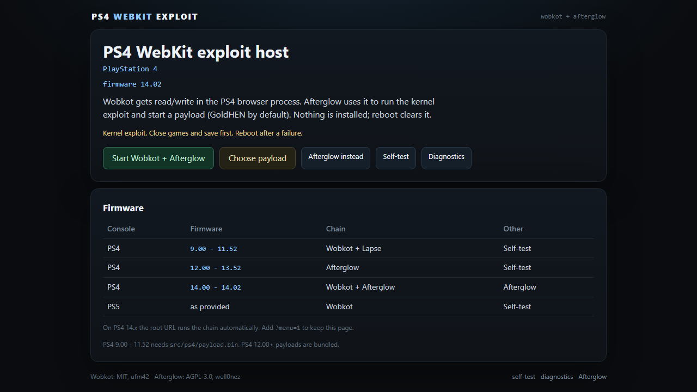
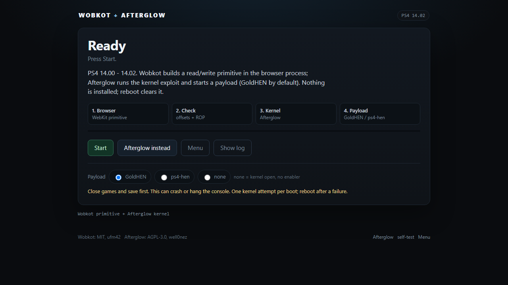
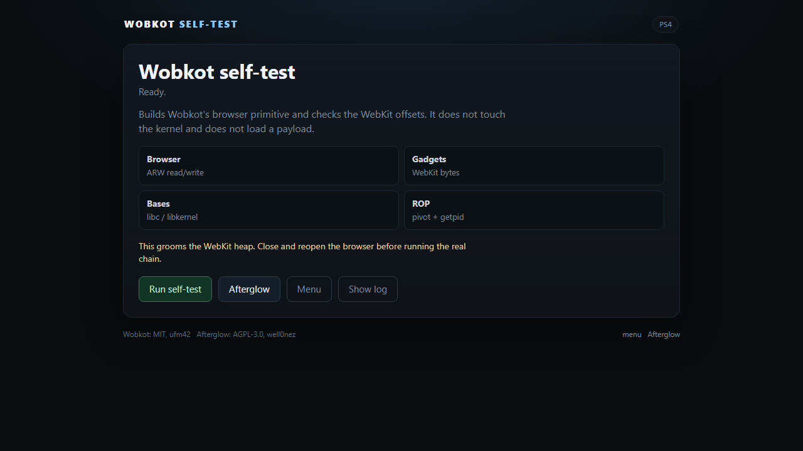
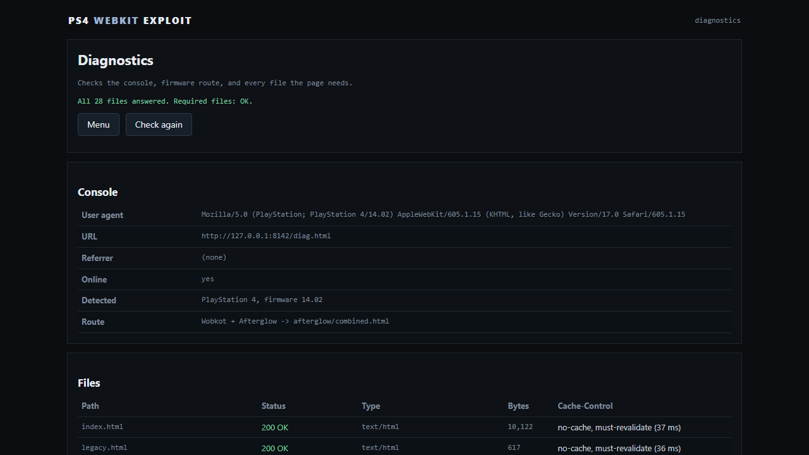

# PS4 WebKit exploit host - Wobkot + Afterglow

Live copy: **https://odiecay.github.io/pwn/**  
Source: **https://github.com/odiecay/pwn**

A self-hosted browser toolkit for PS4 firmware **9.00 - 14.02** and PS5 (as
provided by Wobkot).

The 14.02 path is the point of this build: it combines **Wobkot's WebKit
primitive** with **Afterglow's kernel exploit**. The chain validates every
WebKit address before the first ROP call, then hands the process to Afterglow
for the kernel stage and payload loader. If validation fails, nothing in the
kernel has been touched and the page offers the Afterglow chain.

```text
PS4 14.00 - 14.02   Wobkot primitive + Afterglow kernel   (chain, primary)
                    Afterglow full chain                   (proven fallback)
PS4 12.00 - 13.52   Afterglow full chain
PS4 9.00 - 11.52    Wobkot legacy (Lapse kernel)
PS5                 Wobkot PS5 chain (upstream support)
```

## Screenshots









## What changed from upstream Wobkot

- Added a firmware-aware hub (`index.html`) and a single routing table
  (`src/strategy.js`). The original console page is now `legacy.html`.
- Vendored Afterglow under `afterglow/` for PS4 12.00-14.02, with its own
  `cache.appcache`, payloads and patch sets.
- Added the chain (`afterglow/combined.html` + `src/combined.js`) that
  runs Wobkot's WebKit primitive and Afterglow's kernel stage. It starts
  immediately from the root URL, shows four progress stages, hides the full log
  behind a toggle, and falls back to the proven engine on a safe miss.
- Added the adapter (`src/afterglow_host.js`) with byte-level gadget checks,
  base prechecks and a ROP pivot precheck.
- Added the safe self-test (`primitive-test.html`), diagnostics (`diag.html`),
  a no-cache HTTP server (`host.py`) and the maintenance checks under `tools/`.
- Retired the legacy Lapse path above PS4 11.52, since those firmwares are
  routed to Afterglow.

## Quick start (Windows)

1. **Save your game and close apps.** A kernel exploit can crash or hang the
   console. Do not run this with anything unsaved open. If the console is
   already jailbroken on this boot, reboot before running the exploit again:
   Afterglow refuses to fire against an already-open kernel.
2. In this folder:

   ```powershell
   py host.py
   ```

   On Windows you can also double-click `start.cmd`. The server prints the
   URL(s) to open, for example `http://192.168.1.50:8000/`.
3. On the console, open the browser and go to that URL.
4. The hub detects the console and, on PS4 14.x, redirects straight to the fast
   path. There is no countdown: the chain starts immediately.
5. GoldHEN is the default payload and the choice is remembered in
   `localStorage`. To pick ps4-hen or no payload, open `?menu=1` on the hub,
   then **Choose payload**.

After a kernel attempt, the run page shows **Reboot required**. Cold boot the
console before another attempt; this is what keeps a failed attempt from
compounding into a crash. The only exception is an advanced `?force=1`, which
you should not need.

Confirmed on a retail PS4 14.02: the stable chain completed in **4.0 s**
with the original Wobkot ARW loop, the bulk payload copy and prefetch. A 3.7 s
run used a rewritten ARW spray that was not stable across attempts; that rewrite
has been reverted. The remaining time is Afterglow's kernel exploit.

The run page records the last attempts locally and `host.py` prints one
`[PS4] RUN ok=... sec=...` line per completed run. The page also allows only one
kernel attempt per browser session: after an attempt it shows **Reboot
required** instead of firing again.

If the chain stops at validation, close and reopen the browser before
retrying, or use **Afterglow**. If the log says the handles are
**NOT defused**, do not close the page; cold boot the console.

## Hosting on GitHub Pages

The page is static. `host.py` is a convenience server: it adds the server-side
302, no-cache headers and `/event` logging. GitHub Pages can host the same
files; the client-side hub still routes by user agent.

1. Create a public repository and push this folder to `main`.
2. `.nojekyll` at the root keeps GitHub Pages from processing the files.
3. Settings -> Pages -> Deploy from a branch -> `main` / root.
4. Open `https://<user>.github.io/<repo>/` on the PS4.
5. If the PS4 browser has TLS or caching trouble, use the local `host.py`
   instead. It is also the only version with server-side 302 and run logging.
6. `localhost.pem` is a local self-signed key. It is git-ignored and must not be
   pushed to a public repo; HTTP is the default.
7. Keep the license notices: Wobkot is MIT, Afterglow is AGPL-3.0, and the
   payloads have their own terms.

On a static host, `/event` and `/log` do not exist; the page catches those
failures. The root link and the combined script use cache-busting query strings
so the console does not keep serving an old page. If you land on an old tab
after an update, go to the repository root URL rather than reusing the tab.

## What the chain does

1. Loads the shared logger first, then loads the routing table, Wobkot's
   `misc.js`/`ps4/impl.js`/`userland.js`, the adapter and the Afterglow module
   in parallel.
2. Builds the Wobkot WebKit primitive (ARW + ROP).
3. Exercises the ARW through a real ArrayBuffer backing store.
4. Rebuilds the WebKit base and validates the critical gadgets byte for byte.
   The `pop r8` / `pop r9` checks accept both the `41` and `47` REX encodings.
5. Rebuilds the libc/libkernel bases from the import table and checks them
   before `rop.init()` scans libkernel.
6. Runs `rop.init()`, compares the resulting bases to the precheck, and calls
   `getpid()` as the first ROP execution. The frame check treats `+0x10` as an
   opaque saved slot; on 14.02 it is a JavaScript value, not a frame pointer.
7. Loads Afterglow through `src/afterglow_bridge.js`, gives it a small adapter
   (`sc`, `bufAddr`, `p`, `keepAlive`), and runs its kernel stage.
8. Afterglow loads `goldhen.bin`, `hen.bin`, or no payload.

No kernel address is written until steps 3-6 pass. A failed validation is a
normal page error, not a kernel crash. The main remaining risk is the WebKit
ROP pivot itself; that is why the Afterglow chain remains one tap away.

## Files

```text
index.html                  firmware-aware hub
legacy.html                 Wobkot console page (PS4 9.00-11.52 / PS5)
primitive-test.html         safe WebKit primitive self-test
diag.html                   file/server diagnostics
start.cmd                   Windows: start the host
check.cmd                   Windows: run the static checks
afterglow/                  vendored Afterglow engine, unmodified
afterglow/combined.html     chain UI
src/strategy.js             one firmware -> engine routing table
src/combined.js             chain loader
src/afterglow_host.js       Wobkot -> Afterglow adapter + validation
src/afterglow_bridge.js     ES-module bridge
src/afterglow_fast.js       generated fast module (bulk payload copy)
src/main.js                 legacy Wobkot entry point
tools/check.py              static checks
tools/build_fast_engine.py  regenerate src/afterglow_fast.js
tools/manifest.py           rebuild/verify afterglow/cache.appcache
tools/update_afterglow.py   check/update the vendored Afterglow engine
```

## Adding or updating firmware

### Afterglow

Afterglow owns its own firmware tables:

- `afterglow/ps4_offsets.js` - WebKit and libkernel values
- `afterglow/afterglow.js` - kernel values, bootstrap and patchset selection

When upstream adds a firmware, update the vendored copy:

```powershell
py tools/update_afterglow.py --check
py tools/update_afterglow.py --apply
py tools/manifest.py --check
py tools/check.py
```

`--apply` refuses to overwrite local changes unless `--force` is given.
`afterglow/cache.appcache` must be regenerated after any edit inside
`afterglow/`; `tools/manifest.py --write` does that in the same format as
Afterglow's `make-manifest.sh`. Use `--force` only when you intentionally
changed a vendored file and want upstream to replace it.
`tools/update_afterglow.py --apply` also regenerates `src/afterglow_fast.js`;
if you change the generator, run `py tools/build_fast_engine.py --write`.

### Wobkot `src/ps4/impl.js`

The legacy table is keyed by firmware. For a new PS4 firmware in the legacy
range, add the kernel/WebKit offsets to the matching major/minor entry. The
`impl` Proxy falls back to the nearest lower entry, which is useful for values
that did not move, but do not rely on it for addresses that changed.

### Routing

Add or change the range in `src/strategy.js`. The hub, the legacy page and the
checks all read that file. An unknown firmware is refused rather than run with
someone else's offsets.

## Payloads

See `PAYLOADS.md` for the full per-firmware matrix.

- `afterglow/goldhen.bin` - GoldHEN, bundled by Afterglow. Recommended for
  12.00-14.02.
- `afterglow/hen.bin` - ps4-hen, bundled by Afterglow. The copy is patched for
  the 14.00 `sceSblPfsSetKeys` address; see `afterglow/TECHNICAL.md`.
- `src/ps4/payload.bin` - the raw payload used by the legacy Wobkot chain
  (PS4 9.00-11.52). It is not bundled because the right payload depends on the
  firmware. Drop your own `payload.bin` there before using `legacy.html`.

To replace a payload, keep the same filename and path, then reload the page.
The server sends `no-cache, must-revalidate` for `.bin` files, so the browser
revalidates instead of running a stale payload.

If you replace a file inside `afterglow/`, also rebuild the application-cache
manifest (the console's HTML5 cache only refetches when the manifest changes):

```powershell
py tools/manifest.py --write
```

`tools/check.py` will then report the lock mismatch because the vendored
engine no longer matches upstream; rerun `py tools/update_afterglow.py
--write-lock` if you intentionally changed a vendored file.

## Troubleshooting

| Symptom | Cause / fix |
| --- | --- |
| 404 on a page | `host.py` was started from the wrong directory, or the URL is missing a path. The server serves this folder, not its parent. |
| `No offsets for this firmware` | Afterglow has no exact table for that firmware. Do not force it; wait for an upstream table or use a supported firmware. |
| chain stops at validation | The WebKit offsets did not match. Use **Afterglow**; the kernel was not touched. |
| Page keeps an old build | The server already sends no-cache. Reopen the page; if needed, clear the browser cache. |
| Port 8000 in use | `py host.py --port 8080` |
| Console cannot reach the PC | Allow Python through Windows Firewall on the private network; both devices must be on the same LAN. |
| Browser forces HTTPS | Use the exact `http://...` URL printed by `host.py`. The default server is HTTP; `--https` is optional and uses the bundled localhost certificate. |
| HTTPS certificate warning | Use HTTP (the default). The bundled certificate is for `localhost`, not the console's view of the PC. |
| `handles are NOT defused` | Do not close the browser. Cold boot the console; closing the browser is the process exit that hangs. |
| Console froze after a failed run | Hold the power button until off, then start again. |

## Self-test, diagnostics and debug

- `primitive-test.html` builds only the WebKit primitive, validates gadgets and
  bases, and calls `getpid()`. It does not write the kernel. Run it on 14.02 to
  prove the chain's browser stage. It grooms the WebKit heap, so close the
  browser and reopen it before running the real chain.
- `diag.html` fetches every required file and shows status, MIME type, size and
  `Cache-Control`. A 404 or `text/plain` for a `.js` file is a server problem.
- Add `?debug=1` to the fast-path URL to enable verbose lines and POST the log
  to `host.py` (`[PS4] ...` in the server terminal). Without it, the page keeps
  the log local and shows only the four stages and the result.
- The fast-path page has a **show log** button whenever you need the full
  Wobkot/Afterglow trace. On failure it opens automatically.

## Safety

This is a kernel exploit. It is not persistent; a reboot restores the console.
It does not install anything and does not touch the hard drive. It can still
crash, hang, or leave the browser process in a state that requires a cold boot.
Only run it on hardware you own and on firmware the toolkit lists as supported.

## Credits and licenses

- **Wobkot** - MIT, [ufm42/wobkot](https://github.com/ufm42/wobkot). The
  Wobkot files retain their MIT license (`LICENSE.txt`).
- **Afterglow** - AGPL-3.0, [well0nez/afterglow-web](https://github.com/well0nez/afterglow-web).
  Vendored unmodified under `afterglow/`, including its `LICENSE`.
- **raw13g / slopkit** - components inside Afterglow, under their own terms;
  see `afterglow/TECHNICAL.md` and `afterglow/LICENSE-raw13g`.
- **GoldHEN** - SiSTRo and contributors. `goldhen.bin` is a third-party payload.
- **ps4-hen** - see Afterglow's README for its provenance.

Because this distribution includes AGPL-3.0 code, treat the combined work as
AGPL-3.0. The Wobkot files remain available under MIT. See `THIRD_PARTY.md`.
